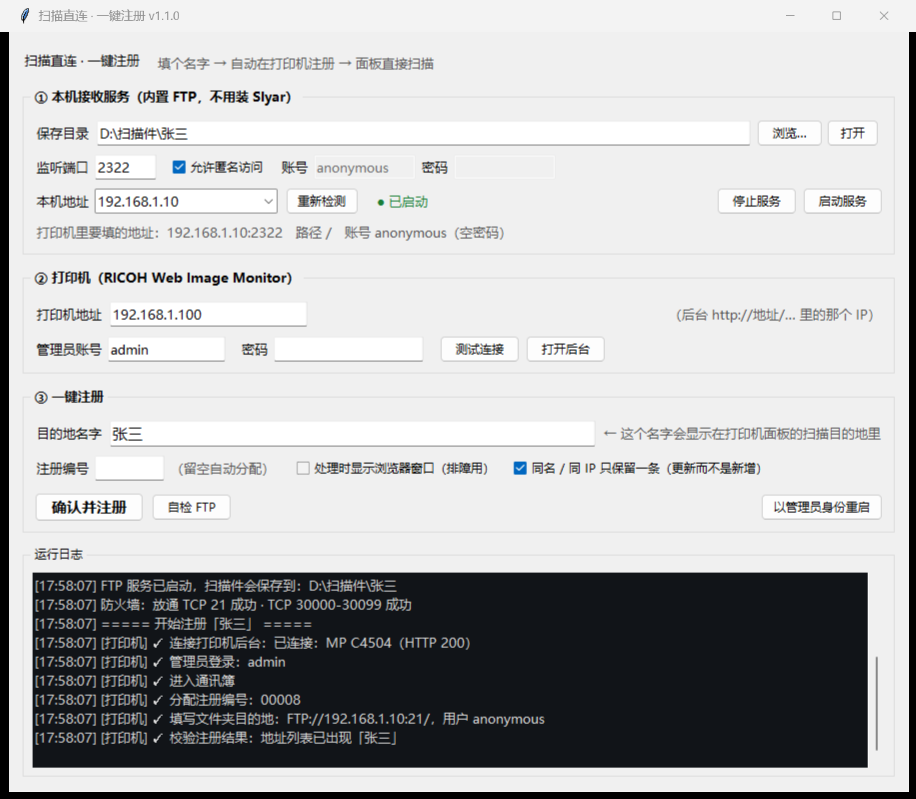

# 扫描直连 · 一键注册

把《打印机扫描直连》那份教程里的 **10 步手工操作**，压缩成 **填一个名字 → 点确认**。

> 教程原文做的事：装 Slyar FTP Server → 设目录/账号 → 启动 → 查本机 IP →
> 打开理光后台 → 管理员登录 → 通讯簿 → 添加用户 → 勾选基本信息+文件夹目的地 →
> Step1 基本信息 → Step2 文件夹目的地 → Step3 确认 → 回面板扫描。
>
> 本程序：内部自带 FTP 服务（不用装 Slyar），自动拿到打印机可达的本机 IP、
> 自动放通防火墙，然后驱动本机 Edge 把打印机后台那套流程点完，
> 最后回地址列表校验「名字」真的出现了。



> **关于本仓库**：文档、截图与测试里出现的 IP（如 `192.168.1.100` / `192.168.1.10`）、
> 主机名、用户名、文件路径**全部是占位示例**，不含任何真实内网信息；
> 你使用时把自己的打印机地址填进 `config.json`（可参考 `config.example.json`）即可。
>
> 适配机型：**RICOH（理光）Web Image Monitor** 系列，例如 MP C4504；其它品牌后台结构不同，需另写自动化模块。

---

## 下载（开箱即用）

不想自己打包就直接下 Release：

- **单文件版** → [ScanLink-v1.1.0-portable.exe](https://github.com/shidaifufen/RICOH_FTP_scan/releases/download/v1.1.0/ScanLink-v1.1.0-portable.exe)（14MB，一个文件拿走即用）
- **文件夹版** → [ScanLink-v1.1.0-folder.zip](https://github.com/shidaifufen/RICOH_FTP_scan/releases/download/v1.1.0/ScanLink-v1.1.0-folder.zip)（14MB，解压后双击 `启动.bat`，启动更快）

全部版本：<https://github.com/shidaifufen/RICOH_FTP_scan/releases>

---

## 一、怎么用（现场 3 步）

**第 1 步：拿到程序**（两种打包，功能一样，选一种）

| 版本 | 长什么样 | 适合 |
|---|---|---|
| **单文件版**（本目录 `扫描直连.exe`） | **只有 1 个 exe（14MB）**，拷到哪都能跑 | 想省事、只想拿一个文件 |
| **文件夹版**（`文件夹版\` 子目录） | `扫描直连.exe`(4.4MB) + `_internal\` | 想要启动快（单文件版每次启动要解包 2~4 秒） |

> 文件夹版**必须整个文件夹一起拷**；只拷 exe 会报
> `Failed to load Python DLL ... _internal\python312.dll`（依赖在 `_internal` 里）。

**第 2 步：启动**：双击 `启动.bat`（不弹 SmartScreen），或直接双击 exe
（未签名程序，可能弹「已保护你的电脑」→「更多信息」→「仍要运行」）。
不用装 Python、也不用装 FTP 软件。

**第 3 步：填三样东西**

| 填什么 | 说明 |
|---|---|
| 打印机地址 | 打印机后台网址里的 IP，例如 `192.168.1.100` |
| 管理员密码 | 理光 Web Image Monitor 的 admin 密码（IT 设的那个） |
| 目的地名字 | 想显示在打印机面板上的名字，例如 `张三`、`财务` |

然后点 **「确认并注册」**。看到"注册完成"后，到打印机面板：
**扫描 → 选择「张三」→ 开始扫描**，文件会直接落到本机保存目录。

程序会自动：启动 FTP 服务、检测本机 IP、放通防火墙、登录打印机后台、
新建通讯簿条目（FTP / 端口 / 服务器=本机 IP / 路径 / 账号）、校验结果。

**保存目录**默认是 **`桌面\扫描`**（自动识别 OneDrive 重定向后的真实桌面路径），
可以改成任意文件夹。

**同名或同一台电脑（同一个 FTP 服务器 IP）再次注册时，只保留一条记录**：
程序会先建好新条目、再删掉旧的那条（注册编号会换新），不会在打印机里越积越多。
不想这样合并可以在界面上取消勾选「同名 / 同 IP 只保留一条」。

---

## 二、它替代了教程里的哪些步骤

| 教程步骤 | 原来要手工做 | 现在 |
|---|---|---|
| 1 | 下载安装 Slyar FTPServer v3.0 | 内置 FTP 服务，已随程序带好 |
| 2① | 设置访问路径 | 界面里选保存目录 |
| 2② | 设置账户权限 | 默认匿名 + 读写权限，可改成指定账号密码 |
| 2③ | 点"启动服务" | 点「确认并注册」时自动启动（也可手动「启动服务」） |
| 3 | `ipconfig` 查本机 IP | 自动选**打印机可达**的那块网卡地址，多网卡/虚拟网卡不会选错 |
| 4① | 浏览器打开打印机后台 | 自动打开（无界面），也可点「打开后台」人工看 |
| 4② | 输入管理员账号密码 | 用界面里填的密码自动登录 |
| 4③ | 设备管理 → 通讯簿 | 自动点 |
| 4④ | 添加用户 → 勾选基本信息 + 文件夹目的地 | 自动勾选 |
| Step1 | 填注册编号/名称/按键显示 | 名字=你填的，注册编号自动取现有最大号 +1 |
| Step2 | 协议选 FTP、端口 21、服务器=本机 IP、路径 `\`、用户名 anonymous | 自动填（路径默认 `/`，可配置） |
| Step3 | 点"确定" | 自动点，并**回地址列表校验**名字确实出现了 |
| 追加 | 名字写错了只能手工删了重加 | 同名/同 IP 再注册 = **自动更新**（先建新的、再删旧的） |

---

## 三、界面上的东西

- **本机接收服务**：FTP 的保存目录、端口（默认 21）、匿名/指定账号、本机地址。
  本机地址默认自动选，可下拉切换。手动启停方便单独测。
- **打印机**：地址 + 管理员账号密码，「测试连接」只探后台在不在（不登录）。
- **一键注册**：目的地名字（必填）、注册编号（留空自动）、
  「处理时显示浏览器窗口」——**现场排障请勾上**，能看到自动点了什么。
- **运行日志**：每一步的 ✅/❌，失败时会打印现场快照路径。
- **系统托盘（右下角图标）**：FTP 运行时右下角常驻图标，鼠标悬停显示
  `扫描直连 · FTP 运行中 192.168.1.10:21`；**双击**打开主界面；**右键**菜单：
  打开主界面 / 看状态 / 复制 FTP 地址 / 启动或停止 FTP / 检查状态 / 打开保存目录 / 退出。
  点窗口右上角 **× 只是收进托盘**，FTP 继续接收；要真正退出请用托盘菜单的「退出」。

---

## 四、常见问题

**又点了一次「确认并注册」，会不会多出一条记录？**
不会。同名、或同一台电脑（同一个 FTP 服务器 IP）会被认成"同一个用户"：
程序先建好新条目、成功后删掉旧的，所以打印机里始终只有一条，名字和目录都是最新的。
（注册编号会变，因为理光的向导不支持改编号。）

**提示「进入服务器的用户数超过最大允许限制」**
理光后台并发管理员会话有限（默认几条）。等 1～2 分钟自动释放，
或者重启一次打印机。本程序现在注册完会自动注销、退出时也会注销，
正常使用不会把会话占满；只有并发开着好几个窗口手工调试时才可能遇到。

**双击 exe 弹「Windows 已保护你的电脑」/ 弹 `Could not create temporary directory!`**
- 前者：程序没有代码签名证书 → 点「更多信息 → 仍要运行」，或**双击 `启动.bat`**（不触发）。
- 后者：那是旧的**单文件版** exe（14MB 单个文件）在解包临时目录时被系统拦了。
  现在已换成**文件夹版**（`扫描直连.exe` + `_internal`），不再解包临时目录；
  如果手上还是 14MB 的单个 exe，说明拿到的是旧版，删掉换新的。

**托盘图标不出现 / 保存目录提示"拒绝访问" / 注册时"浏览器启动失败"**
先看 `logs\env-report.txt`。如果它是 `管理员: True` 但三个"写入测试"全是"拒绝"，
说明程序**不是在正常桌面会话里启动的**（例如通过 AI 助手、自动化脚本、沙箱终端、
计划任务以外的受限容器启动）。这种受限容器里会出现三个连环症状：
- `Shell_NotifyIcon` 报错误码 5 → 托盘图标加不上；
- 桌面/文档都写不进去 → 保存目录报 `WinError 5 拒绝访问`；
- 浏览器的**渲染进程起不来** → `Page.enable`/`Runtime.evaluate` 全部超时。

→ 解决：**在 Windows 资源管理器里双击 `启动.bat`**（或 exe）。正常桌面会话下三个问题都不会出现。

**注册时提示「浏览器启动失败：Page.enable 超时」**
这是打包版（PyInstaller 冻结环境）里 Chromium 渲染进程起不来的老问题，已修复：
启动 Edge 时加了 `--no-sandbox`（该实例只访问局域网打印机后台，不浏览外网）。

**单文件版 vs 文件夹版 怎么选**
- 只想拷一个文件 → **单文件版**（本目录 `扫描直连.exe`）。首次启动会解包到
  `%LOCALAPPDATA%\扫描直连\tmp`，慢 2~4 秒；杀软可能对它更敏感。
- 想启动快、天天用 → **`文件夹版\`**（exe + `_internal` 一起拷）。
- 两者功能相同，config.json / logs 各自独立。

**不想开界面，直接跑一次注册（排障 / 自动化）**
```bat
扫描直连.exe --cli-register 张三 --printer 192.168.1.100
```
结果写进 `logs\cli.log`，退出码 0 = 成功。加 `--password xxx` 可临时指定管理员密码。

**打印机连不上（测试连接超时）**
- 确认本机和打印机在同一网段/能互通（交换机和 VLAN 都可能拦）。
- 打印机 IP 会变：建议 IT 给打印机配固定 IP 或 DHCP 保留。
- 打印机后台是 HTTP 80；如果被改成 HTTPS 或别的端口，目前不支持。

**能登录，但注册失败**
- 打开 `logs\debug\` 里最新的 `.png` / `.html`，那就是失败瞬间的界面。
- 最常见：管理员密码错、页面元素和预期不同（固件版本差异）、
  通讯簿里已有同名条目（程序会直接拦住，提示换名字或先删旧的）。
- 把那张截图发我，基本能一次定位。

**打印机面板看不到新名字**
- 程序注册时默认勾了「添加到常用」；如果还是看不到，去面板
  **通讯簿 → 用户列表**里找（注册编号就是程序分配的那个）。
- 有些机器需要在面板上「刷新」或重启一次才显示新通讯簿。

**扫描报"无法连接文件夹" / 上传超时**
- 这是**FTP 数据通道**被拦的典型现象：控制端口 21 通了，被动端口没通。
- 本程序启动时会尝试自动放通 21 与 30000-30099；
  如果当时不是管理员权限，改用 **「以管理员身份重启」** 再来一次。
- 也确认 Windows 网络属性里当前网络是"专用网络"而不是"公用网络"。

**改了文件保存目录**
- 打印机里存的只是 FTP 地址和路径，不存绝对路径，所以改本机目录**不影响**已注册的条目。

**端口 21 被占用**
- 常见是旧 Slyar 服务还在跑。关掉它，或把端口改成 2121，
  但注意：**改了端口要重新注册**（打印机条目里记的是端口号）。

---

## 五、工作原理（给维护的人看）

```
┌ 主界面 (tkinter) ────────────────────────────────────────┐
│ ① FtpScanServer   pyftpdlib，被动端口 30000-30099，       │
│                    masquerade_address = 打印机可达本机 IP │
│ ② netinfo         向打印机 IP 发包看内核从哪块网卡出去     │
│ ③ firewall        netsh 放通控制端口 + 被动端口段          │
│ ④ RicohRegistrar  CDP 驱动 Edge 点完通讯簿向导并校验       │
└──────────────────────────────────────────────────────────┘
```

几个关键点，改代码前先读：

1. **FTP 必须设 `masquerade_address` 和 `passive_ports`**
   否则 PASV 响应会回 `127.0.0.1` 或错网卡地址，打印机"能登录但传不了"。
2. **打印机自动化走真实界面，不猜 CGI 参数**
   用 CDP（Chrome DevTools Protocol）驱动 Edge，靠界面上的中文标签定位：
   「添加用户」「转到下一项」「文件夹目的地」「确定」。
   理光的 CGI 隐藏字段/令牌随固件变，界面上这些字多年稳定。
3. **CDP 的两个坑**（`app/cdp.py` 里已处理）
   - 事件只在等命令响应时才被读取，所以每步之后要 `pump()`；
   - frameset 的子 frame 导航后上下文不一定重建，用
     `Page.getFrameTree` + `Page.createIsolatedWorld` 兜底。
4. **注册编号**：先读地址列表里现有的 5 位编号，取最大值 +1。
5. **重名保护**：同名条目已存在时直接报错，不做"偷偷覆盖"。
6. **失败必留证据**：任何一步失败都会把截图 + 各 frame HTML 存到
   `logs\debug\`，这是现场排障最重要的一手信息。
7. **打印机的 Field 规则**：协议选 FTP、端口 21、服务器=IP（不要带 `ftp://`）、
   路径用 `/`（教程里写的 `\` 也能用）、匿名用户 `anonymous` 空密码。
8. **一次会话一个浏览器**：`CdpBrowser` 由界面持有并复用。
   因为 Edge/Chrome 每新开一个进程都会产生一次 Windows 失败登录事件（4625），
   默认「10 次 / 10 分钟」的账户锁定策略下，反复新开浏览器会把本机账户锁死
   （PIN 报 0xC0000234）。背景见第十二节。
9. **"同一个用户"用先建后删实现**：理光的「更改」向导是页内模态 + AJAX，自动化点不进去；
   而删除可以可靠完成（勾行 → 删除 → 自动确认）。所以更新 = 先注册新条目 → 校验成功
   → 再按注册编号删旧的。中途失败也不会丢原有条目。
10. **自动注销后台会话**：理光后台并发会话有限，注册完 / 退出程序都会点「注销」。

---

## 六、目录结构

```
扫描直连/
├─ 扫描直连.exe          单文件版（14MB，一个文件拿走即用）
├─ 文件夹版\             文件夹版（exe + _internal，启动更快）
├─ 首次运行说明.txt       给现场同事看的启动/排障说明
├─ 扫描直连_文件夹版.zip   整个程序的便携压缩包（拷到现场解压即用）
├─ 启动.bat              启动脚本（不触发 SmartScreen，推荐双击这个）
├─ setup.bat             重新安装 vendor 依赖
├─ main.py               源码入口（PyInstaller 也用它）
├─ requirements.txt
├─ config.json           记住上次填的内容（运行后生成）
├─ vendor/               依赖（pyftpdlib 等，随目录拷走即可用）
├─ app/
│  ├─ main.py            界面 + 一键注册流程编排
│  ├─ ftp_server.py      内置 FTP 服务
│  ├─ netinfo.py         本机 IP 探测
│  ├─ firewall.py        Windows 防火墙放通
│  ├─ cdp.py             Chrome DevTools Protocol 客户端
│  ├─ printer_ricoh.py   理光通讯簿自动注册
│  └─ config.py          配置持久化
├─ tests/
│  ├─ test_ftp.py            FTP 端到端（上传/下载/回调）
│  ├─ test_cdp.py            CDP 多 frame 点击/填表/截图
│  ├─ test_registration.py   对着"假理光后台"跑完整注册流程
│  ├─ test_gui.py            界面烟雾测试
│  ├─ mock_wim.py            假理光 Web Image Monitor
│  └─ debug_*.py             分步调试脚本
├─ docs/界面.png
└─ logs/
   ├─ app.log             界面版运行日志（含托盘/浏览器等后台线程的错）
   ├─ env-report.txt       每次启动自动生成的环境自检（排障先看这个）
   ├─ cli.log             --cli-register 模式的日志
   └─ debug/              注册失败瞬间的截图 + HTML
```

---

## 七、测试

不需要打印机，也不需要网络：

```bat
rem 用能跑 Python 的那台机器（或打包机的 Python）
set PY=你的python.exe
%PY% tests\test_ftp.py           最慢几秒
%PY% tests\test_cdp.py           需要本机有 Edge
%PY% tests\test_registration.py  对着假理光后台跑全流程（约 40 秒）
%PY% tests\test_gui.py
rem 想用浏览器手工点一遍假后台：
%PY% tests\mock_wim.py           然后浏览器开 http://127.0.0.1:18888/web/guest/cn/websys/webArch/mainFrame.cgi
```

`tests/mock_wim.py` 是按教程截图复刻的假理光后台（frameset、中文标签、三步向导），
所以**没打印机也能验证自动注册逻辑**。真机第一次跑建议勾上"显示浏览器窗口"。

---

## 八、已知限制

- 只针对 **理光 Web Image Monitor**（教程里的 RICOH MP C4504 系列）。
  其它品牌（佳能/惠普/柯尼卡…）后台结构不同，需要另写一个
  `printer_xxx.py`，但 FTP 服务、IP 探测、防火墙、界面都能复用。
- 目的地类型只做 **FTP 文件夹**（教程就是 FTP）；SMB 需要另外验证路径/凭据规则。
- 需要 Edge 或 Chrome（Windows 10/11 自带 Edge 即可）。
- 管理员密码存在 `config.json` 里（明文，仅本机）。介意的话每次手输即可。
- **托盘图标已经有了**：FTP 运行时右下角常驻，点窗口 × 收进托盘继续跑。
  还**没有**做「开机自动启动」（需要的话加一个启动项即可）。
- 理光后台并发管理员会话有限，占满时会提示"进入服务器的用户数超过最大允许限制"，
  等 1-2 分钟或重启打印机即可；程序已自动注销，正常使用不触发。
- 只按「名字 / FTP 服务器 IP」识别同一个用户：不要在两台电脑上注册同一个名字
  （会互相覆盖）；也不要指望同一台电脑注册出多个不同目录（同一 IP 只保留一条）。

---

## 九、自己重新打包 exe

改完代码想重新出包（需要能上网装 PyInstaller）：

```bat
set PY=C:\你的python.exe
set PYTHONPATH=%~dp0tools
%PY% -m PyInstaller --noconfirm --clean --onedir --noconsole ^
  --name 扫描直连 --distpath "%~dp0build\dist" --workpath "%~dp0build\work" --specpath "%~dp0build" ^
  --add-data "%~dp0vendor;vendor" --add-data "%~dp0app\scanlink.ico;app" --icon "%~dp0app\scanlink.ico" ^
  --hidden-import pyftpdlib --hidden-import pyftpdlib.servers ^
  --hidden-import pyftpdlib.handlers --hidden-import pyftpdlib.authorizers ^
  --hidden-import pyasynchat --hidden-import pyasyncore ^
  "%~dp0main.py"
rem 然后把 build\dist\扫描直连\ 下的 exe 和 _internal 拷到项目根目录
```

> **为什么用 --onedir 而不是 --onefile**：单文件版每次启动都要把自己解包到
> `%TEMP%\_MEIxxxx`；在部分机器上（SmartScreen / 杀软 / 临时目录策略）这一步会被拒，
> 表现为弹窗 **`Could not create temporary directory!`**，程序根本起不来。
> 文件夹版不解包、直接跑，没有这个环节，启动也更快。

- `tools\` 就是放在项目里的 PyInstaller（8MB），上面的 `PYTHONPATH` 让它可用；
  删掉它也不影响运行，只是重新打包前要再 `pip install pyinstaller`。
- `vendor\` 会被原样打进 exe（`--add-data`），所以现场机器不需要 pip 环境。
- 打完运行 `python tests\verify_exe.py` 验证：会启动 exe、确认窗口标题出现、
  并检查 `config.json`/`logs` 落在 exe 旁边（而不是解包出来的临时目录）。

> 小坑：如果你在**自动化/沙箱环境**里用 `subprocess` 直接拉 exe，可能报
> `Could not create temporary directory!` —— 那是单文件版解包被受限 Job 拦住了，
> 用户双击或 `tests\verify_exe.py`（走 WMI）都正常。

---

## 十、这次交付的验证情况

| 验证项 | 结果 |
|---|---|
| FTP 端到端（300KB 上传 / 中文名 / 下载 / 自检 / 端口占用） | ✅ 5 项通过 |
| CDP 驱动（多 frame 点击 / 按标签填表 / 单选 / 截图） | ✅ 6 项通过 |
| 完整注册流程（对着复刻的假理光后台跑教程 10 步） | ✅ 5 项通过 |
| 界面（配置读写 / 日志 / FTP 启停 / IP 探测） | ✅ 5 项通过 |
| 打包版 exe（窗口出现 + 写文件目录正确） | ✅ PASS |

**还没有验证的**：真机 `192.168.1.100`（RICOH MP C4504）—— 它当前不在本机可达网段，
注册那一步是照着教程截图实现的，需要在能连到打印机的机器上第一次实跑。
第一次实跑建议勾上「处理时显示浏览器窗口」；如果某一步的界面元素与预期不同，
`logs\debug\` 下的截图 + HTML 足够定位（把那一对文件发我即可）。
---

## 十一、交付清单

| 文件 | 说明 |
|---|---|
| `扫描直连.exe` | **单文件版**：一个文件拿走即用（14MB，启动时解包到 LocalAppData，慢 2~4 秒） |
| `文件夹版\` | **文件夹版**：exe + `_internal`，启动更快，必须整个文件夹一起拷 |
| `启动.bat` | 推荐启动入口（不触发 SmartScreen；有 exe 就启 exe，没有就找 Python 跑源码） |
| `setup.bat` | 源码模式下重装 `vendor` 依赖 |
| `首次运行说明.txt` | 给现场同事的一页说明（启动方式、SmartScreen、排障） |
| `扫描直连_文件夹版.zip` | 便携压缩包：拷到现场解压即用 |
| `README.md` | 本文件 |
| `docs\界面.png` | 界面截图 |
| `app\` | 源码（7 个模块：界面/FTP/IP/防火墙/CDP/理光自动化/托盘） |
| `tests\` | 27 个自动化测试 + 假理光后台 + 打包版/托盘验证 + 真机工具 |
| `vendor\` | 运行期依赖（pyftpdlib 等），随目录拷走即可 |
| `tools\` | 打包用的 PyInstaller（8MB，删了不影响运行，只影响重新打包） |
| `logs\` | 运行日志；出问题时看 `logs\debug\` 里的截图和 HTML |

---

## 十二、已知的坑：跑测试可能把本机 Windows 账户锁死（PIN 报 0xc0000234）

**2026-10-30 在本机（Windows 11 26H2 / Build 26300，Edge 156）实测确认并已修复。**

**现象**：锁屏输入 PIN 时提示「出现问题，你的 PIN 不可用（状态: 0xc0000234，子状态: 0x0）」，重启也不恢复；
只能点「登录选项 → 密码」进来，或干等 10 分钟。

**原因链**（事件日志证据：Security 4625/4740，HelloForBusiness 7001）：

1. 本机本地账户锁定策略是 Windows 默认的 **10 次 / 10 分钟**（`net accounts`）。
2. Edge/Chrome 156 **每启动一个新浏览器进程（新的 `--user-data-dir`）**都会发一次 Windows 交互式登录
   （4625，LogonProcess=Advapi，错误密码），Chrome 甚至 2 次。这和打印机页面无关，
   打开 `about:blank` 也一样；用已存在的普通浏览器 profile 则不会。
   → 推测是浏览器新 profile 初始化时的一次凭据/Hello 相关调用，换 Chrome 同样复现。
3. `tests\test_*.py` 一轮会启动十几到几十个浏览器（每次 ≈ 1 次失败登录），10 次就把 当前登录账户 锁了（4740）。
   之后 PIN 登录直接返回 0xC0000234（= STATUS_ACCOUNT_LOCKED_OUT），锁屏显示「PIN 不可用」。

**结论**：跟 Windows Hello 摄像头/驱动无关；`重启` 也没用，因为锁定窗口还没过去。

**本机已做的处理**：

```bat
net accounts /lockoutthreshold:0     :: 关闭账户锁定（本机已执行；要恢复就改成 10）
```

**给开发和现场部署的注意**：

- 跑 `tests\test_*.py` 或连续多次点「确认并注册」的机器，建议先执行一次
  `net accounts /lockoutthreshold:0`（管理员），否则连续 10 次就会把当前登录用户锁住。
- 每次「确认并注册」都会新起一个浏览器（= 1 次失败登录）；**失败后别连着点十几次**，
  先看 `logs\debug\` 里的截图定位问题。
- 如果客户机器上不方便关锁定策略，最低限度是把阈值改大（例如
  `net accounts /lockoutthreshold:50`），别用默认的 10。

**代码层面的修复（已实现）**：

1. **一次会话只启动一次浏览器**：`app/main.py` 持有唯一的 `CdpBrowser`，多次点
   「确认并注册」复用同一个浏览器进程（日志里会写"复用已启动的浏览器"）；
   只有浏览器崩了才重建。注册完成后还会**主动注销**打印机后台会话。
2. **测试也复用浏览器**：`tests/test_cdp.py`、`tests/test_registration.py`
   改成整个测试类共用一个浏览器实例。
3. 效果：真正需要"新开浏览器"的只剩**每次启动程序的第一下注册**，
   一次启动 = 1 次失败登录，默认 10 次/10 分钟的策略下基本不可能再被锁。

**顺带发现的一个真机约束**：理光后台**并发管理员会话数有限**，占满后进通讯簿会报
「进入服务器的用户数超过最大允许限制」。现在程序注册完自动注销、退出时也注销，
并且会把这个提示翻译成人话（见第三节"已知限制"）。

---

## 十三、真机实测记录

设备：`http://192.168.1.100`　**RICOH MP C4504**（主机名 `RNP0000000000`，与教程截图同一台）
管理员：`admin` / 空密码　实测环境：Windows 11 + Edge

| 环节 | 结果 |
|---|---|
| 连通性（80/443/21/9100） | ✅ 全通，源地址 `192.168.1.10` |
| 后台识别 | ✅ `已连接：RICOH MP C4504（HTTP 200）` |
| 管理员登录（空密码） | ✅ 成功（页眉变为「注销 / 管理员」） |
| 设备管理 → 通讯簿 → 简易输入 | ✅ 全部点通 |
| 地址列表读取 | ✅ 读到 46/49 条，最大编号 00103 |
| **完整注册** | ✅ 新建编号 **00104「扫描直连测试」**，点「确定」后校验通过 |
| 回读核对 | ✅ 行内容 `00104 / 扫描直连测试 / 192.168.1.10:/`（协议 FTP、端口 21、路径 `/`、用户 anonymous） |
| 面板实际扫描收文件 | ⏳ 本机起了 30 分钟接收服务，没有收到文件——**打印机 → 本机**方向（跨网段）可能被网络/防火墙拦；需在接收机所在网段现场再试一次 |

真机上暴露并已修复的问题（假后台测不出来）：

1. **地址列表是异步加载的**：页面先显示「正在读取…」，表格行随后由 XHR 填入。
   早读会拿到空列表 → 误判"没有重名"、自动编号也会算错。
   现在改成轮询到"行数连续 3 次不变"为止，并把所有 5 位编号都扫一遍取最大值。
2. **首页是 frameset，HTML 里没有型号**：`probe_printer` 原来靠 `RICOH ... Web Image Monitor`
   识别，会退化成"RICOH 设备"。现在补一次 `topPage.cgi` 请求，正确显示 `RICOH MP C4504`。
3. 这台的地址列表条目比教程截图多（从 49 涨到 52），所以**不能写死编号**，必须每次读。

删除测试条目：打印机后台 → 设备管理 → 通讯簿 → 勾选「扫描直连测试」→ 删除。
（如果经常需要换名字，可以再给工具加一个"删除/改名目的地"功能。）

### 第二轮（修完锁死/合并/托盘之后）真机验证

| 验证项 | 结果 |
|---|---|
| 同名再注册（浏览器复用） | ✅ 00106 → 00107：先建新条目、校验成功、再删旧条目，通讯簿只剩一条 |
| 一次会话只开一个浏览器 | ✅ 两次注册的日志都出现"复用已启动的浏览器" |
| 注册后自动注销 | ✅ 日志"已注销后台会话"，不再占着打印机后台会话 |
| 删除指定条目 | ✅ 勾行 → 删除 → 自动确认，按注册编号精确删除 |
| 打印机并发会话上限 | ✅ 遇到并复现"进入服务器的用户数超过最大允许限制"，程序现在给出人话提示；等 1-2 分钟自动恢复 |
| 清理 | ✅ 测试条目（00104/00105/00107）全部删除，**原有 49 条一个没动** |
| 托盘图标 | ✅ dev 环境 4 项测试通过（图标注册/菜单随状态变化/提示更新/点×收进托盘）；打包版在自动化上下文里 `Shell_NotifyIcon` 被拒（错误码 5），需用户双击时确认一眼 |

真机还暴露并修掉的两个问题：

4. **通讯簿入口要重试**：删完条目后页面状态会变，紧跟着再进「设备管理 → 通讯簿」可能点不到；
   现在会重新打开后台、必要时重新登录再试一次。
5. **打印机后台并发会话有限**：占满时报"进入服务器的用户数超过最大允许限制"，
   程序会自动注销 + 把这个提示翻译成人话。

---

## 十四、启动方式很重要（2026-10-30 补充）

程序必须**在正常桌面会话里启动**（资源管理器双击 `启动.bat` / exe）。
通过 AI 助手、自动化脚本、沙箱终端等**受限容器**启动时会出现：

| 症状 | 原因 |
|---|---|
| `[托盘] Shell_NotifyIconW(NIM_ADD) 失败（错误码 5）` | 受限令牌不允许向任务栏注册图标 |
| `[FTP] 保存目录不可用：[WinError 5] 拒绝访问` | 容器里桌面/文档不可写（`logs\env-report.txt` 三个写入测试全"拒绝"） |
| `浏览器启动失败：Page.enable 超时` / `Runtime.evaluate 超时` | 容器里 Chromium 渲染进程起不来 |

判据：打开 `logs\env-report.txt`，正常机器应该是"管理员:True/False"+"写入测试 桌面\扫描: 可写"。
如果"管理员: True 但写入全拒绝"，就是容器环境，换到资源管理器双击即可。

另外打包版曾有一个**独立的真 bug**：PyInstaller 冻结环境下 Edge 渲染进程假死
（`Browser.getVersion` 正常、`Page.enable` 永远超时）。修复方式是给 Edge 加 `--no-sandbox`
（只影响本程序启动的这个无头 Edge 实例，它只访问局域网打印机后台）。

---

## 十五、2026-10-30 真机端到端验收（已通过）

现场实测（RICOH MP C4504 @ 192.168.1.100，程序跑在 WLAN 机器 192.168.1.10）：

```
✅ 注册成功，注册编号 00106（「张三」；旧条目 00090 按"同名/IP 只保留一条"自动替换）
192.168.1.100 登录 FTP → STOR 20261030160615392.pdf completed bytes=1574387
📄 收到扫描文件：D:\扫描件\20261030160615392.pdf（1537 KB）
窗口已收进托盘，FTP 继续运行；环境自检：桌面\扫描 可写 / 托盘 可用
```

即：**输入名字注册 → 打印机面板扫描 → 文件落到 `桌面\扫描` → 托盘常驻**，全链路打通。
